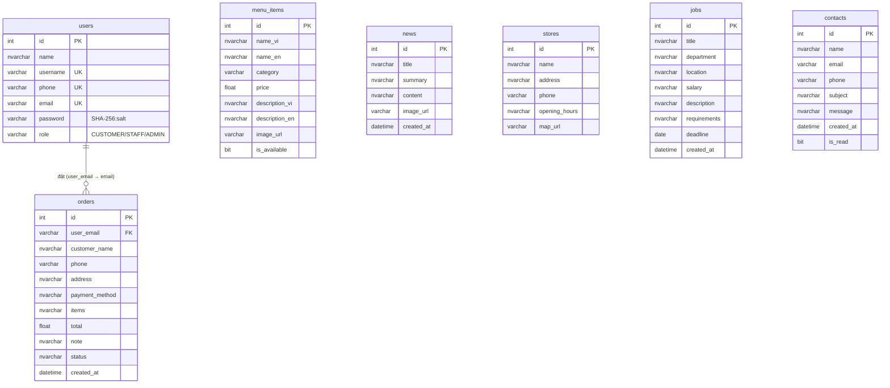

# 🐻 Jolliebear — Website Đặt Đồ Ăn Nhanh

Ứng dụng web bán đồ ăn nhanh (mô phỏng Jollibee/McDonald's) xây dựng bằng **Java Servlet + JSP** theo mô hình **MVC**, dùng **SQL Server** (chạy trong Docker) làm cơ sở dữ liệu.

## 🛠 Công nghệ sử dụng
| Thành phần | Công nghệ |
|---|---|
| Ngôn ngữ | Java 21 (Jakarta EE) |
| Web | Servlet 6.0, JSP, HTML/CSS/JavaScript |
| CSDL | Microsoft SQL Server 2022 (Docker) |
| Thư viện | Gson (JSON), MSSQL JDBC, Chart.js |
| Máy chủ | Apache Tomcat 11 |
| Công cụ | Eclipse, DBeaver, Docker |

## ✨ Tính năng

### Khách hàng
- Xem thực đơn (tìm kiếm, lọc theo danh mục), tin tức, cửa hàng, tuyển dụng, khuyến mãi
- **Giỏ hàng** dạng ngăn kéo trượt (thêm/xoá/đổi số lượng)
- **Đặt hàng 2 bước** (thông tin giao hàng → phương thức thanh toán) — *bắt buộc đăng nhập*
- **Trang cá nhân**: xem lịch sử đơn, theo dõi trạng thái, **huỷ đơn** (khi còn "Chờ xử lý")
- Đăng ký (có username), đăng nhập bằng **username / email / SĐT**, **quên & đổi mật khẩu**
- Gửi liên hệ, chuyển đổi ngôn ngữ VN/EN (một phần)

### Quản trị (ADMIN / STAFF)
- **Tổng quan**: thống kê + **biểu đồ doanh thu 7 ngày** & đơn theo trạng thái (Chart.js)
- Quản lý: thực đơn, tin tức, cửa hàng, tuyển dụng, ý kiến liên hệ
- **Quản lý đơn hàng**: xem tất cả đơn, đổi trạng thái
- **Quản lý thành viên** (chỉ ADMIN): thêm nhân viên bằng email, sửa/xoá tài khoản

## 🔐 Bảo mật
- Mật khẩu **băm SHA-256 + salt** (không lưu plaintext)
- **Servlet Filter** chặn truy cập trang quản trị ở phía server
- Toàn bộ truy vấn dùng **PreparedStatement** (chống SQL Injection)
- **Escape HTML** khi hiển thị dữ liệu người dùng (chống XSS)
- **Tính lại tổng tiền ở server** theo giá trong DB (chống sửa giá)
- Phân quyền theo vai trò (CUSTOMER / STAFF / ADMIN) trên mọi API

## 🗂 Sơ đồ cơ sở dữ liệu (ERD)



> Toàn bộ bảng được **tự động tạo và nạp dữ liệu mẫu** khi ứng dụng chạy lần đầu (xem `DBConnection.java`). Không cần chạy script SQL thủ công.

## 🚀 Cách chạy

### 1. Chạy SQL Server bằng Docker
```bash
docker run -e "ACCEPT_EULA=Y" -e "MSSQL_SA_PASSWORD=Tst@28042009" \
  -p 1433:1433 --name sqlserver -d mcr.microsoft.com/mssql/server:2022-latest
```

### 2. Cấu hình kết nối
Sửa `src/main/resources/db.properties` (hoặc `WEB-INF/classes/db.properties`) cho khớp:
```properties
db.host=localhost
db.port=1433
db.name=Jolliebear_SQL
db.user=sa
db.password=Tst@28042009
```
*(Nếu thiếu file này, app dùng cấu hình mặc định trong code.)*

### 3. Kết nối DBeaver (để xem CSDL)
New Connection → **SQL Server** → Host `localhost`, Port `1433`, User `sa`, Password như trên.
Tab **Driver properties**: đặt `trustServerCertificate = true`.

### 4. Chạy trong Eclipse
- Import project → chuột phải project → **Run on Server** (Tomcat 11)
- Truy cập: `http://localhost:8084/Jolliebear/` *(cổng tuỳ cấu hình Tomcat)*

## 👤 Tài khoản mặc định
| Vai trò | Đăng nhập | Mật khẩu |
|---|---|---|
| ADMIN | `admin` | `admin123` |

*(Khách hàng tự đăng ký tài khoản mới trên web.)*

## 📁 Cấu trúc dự án
```
src/main/
├── java/com/jolliebear/
│   ├── controller/   # Servlet (Login, Register, Order, Admin, Menu, News...)
│   ├── dao/          # Truy xuất CSDL (UserDAO, OrderDAO, MenuItemDAO...)
│   ├── model/        # Đối tượng (User, Order, MenuItem, News...)
│   ├── filter/       # AuthFilter — chặn trang quản trị
│   └── util/         # PasswordUtil — băm mật khẩu
├── resources/
│   └── db.properties # Cấu hình kết nối DB
└── webapp/
    ├── *.jsp         # Trang giao diện (index, menu, cart, profile, dashboard...)
    ├── common/       # header.jsp, footer.jsp (dùng chung)
    ├── css/  js/     # Giao diện & script
    └── WEB-INF/web.xml
```

## ⚠️ Hạn chế đã biết
- Chuyển ngôn ngữ VN/EN mới dịch một phần (các trang thêm sau chưa gắn i18n đầy đủ).
- Đơn hàng lưu danh sách món dạng chuỗi tóm tắt (chưa tách bảng `order_items` chuẩn hoá).
